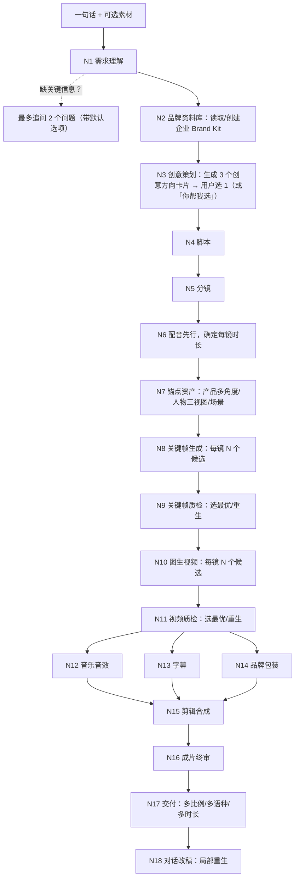

# 「一句成片」企业 AI 视频生成系统 · 技术实施方案

> **转写说明（仓库头注）**
> - 正式产品名：**HiLatv**；文中代号「一句成片」保持原文不改。
> - 仓库根目录为 `hilatv/`（原文 §3.3 中写作 `yijuchengpian/`，以 `hilatv/` 为准）。
> - 本文件由《涌现言源_一句成片_技术实施方案.pdf》（V1.0，2026-10-30，19 页）逐章转写为 Markdown，未修改任何产品方向、数字、验收阈值或规则；仅修复 PDF 抽取造成的断行、项目符号错位、页眉页脚等问题。转写中存在判断的地方以 `<!-- 转写假设: ... -->` 注释标出。

青岛涌现言源智能科技有限公司 · 内部技术文档 · V1.0（2026-10-30）

代号：一句成片（正式产品名待定）

<!-- 转写假设: 原文“正式产品名待定”保留原样；现已确定正式产品名为 HiLatv，见上方头注。 -->

---

## 0. 本文档怎么用

本文档同时写给两类读者：

1. **团队成员**：了解产品要做成什么样、分几步做、每一步的验收标准。
2. **AI 编码代理**（Claude Code、Codex、Cursor 等）：可整份放进仓库根目录作为 `SPEC.md`，并在 `AGENTS.md` / `CLAUDE.md` 中写一句「所有实现以 SPEC.md 为准，按第 13 章任务清单顺序推进，每完成一项跑对应验收」。

**写给 AI 编码代理的总规则：**

- 每个节点（第 6 章）都是一个独立模块，输入输出必须是第 5 章定义的 JSON 结构，严禁节点之间直接传自由文本。
- 所有模型调用必须经过「模型网关」（第 8 章），业务代码里不允许出现任何厂商 SDK。
- 每个节点必须有：输入校验、超时、重试、质检、日志、可单独重跑。
- 任何会出现在画面里的文字、Logo、价格、电话，一律由后期渲染层叠加，禁止让图像/视频模型画字。
- 不复制 LibTV 或 BeefTV 新版（Source Available 许可部分）的任何代码、提示词或界面素材；只参考公开思路，全部自行实现。

---

## 1. 产品定义

### 1.1 一句话定位

企业用户说一句话（可附产品图、Logo、链接），系统自动交付一条可直接发布的商业短视频，质量对标 LibTV 专业创作者手工搭建工作流的成片。

### 1.2 目标用户

| 用户 | 典型诉求 | 他们不想做的事 |
|---|---|---|
| 制造业企业（市场部/老板） | 产品宣传片、工厂实力片、展会视频 | 学提示词、选模型、调参数 |
| 外贸企业 | 多语种产品视频、TikTok/YouTube 投放素材 | 每个语种重做一遍 |
| 电商/零售 | 主图视频、带货短视频、批量上新 | 每个 SKU 单独拍 |
| 本地生活（餐饮、酒店、美业） | 探店视频、活动海报视频 | 请拍摄团队 |
| 教育培训 | 课程宣传、知识讲解短片 | 写分镜 |
| 政企/园区 | 宣传片、政策解读、招商视频 | 反复修改沟通 |

### 1.3 与 LibTV 的差异

| 维度 | LibTV | 一句成片 |
|---|---|---|
| 用户 | 专业创作者 | 企业非专业用户 |
| 交互 | 无限画布 + 节点，手动搭建 | 对话为主，画布为「专家模式」可选 |
| 品牌一致性 | 用户自己管 | 品牌资料库（Brand Kit）自动套用 |
| 产品保真 | 依赖模型 | 真实产品图合成 + 后期叠加文字/Logo，零失真 |
| 质量保证 | 用户肉眼挑 | 每个节点多候选 + 视觉模型自动评审 + 自动修复 |
| 改稿 | 用户自己找节点重跑 | 一句话改稿，系统定位到具体镜头局部重生 |
| 交付 | 单条视频 | 一次出多比例、多语种、多时长版本 |

### 1.4 成功标准（Demo 验收线）

- 从输入一句话到第一版成片：≤ 15 分钟（30 秒视频）。
- 盲评：同一需求下与 LibTV 熟练用户手工成片对比，内部 + 外部 10 人盲评，胜率或平局 ≥ 50%。
- 成片硬伤率（产品变形、文字乱码、人物崩坏、穿帮）≤ 5%（按镜头计）。
- 产品 Logo、文字、包装 100% 与原图一致。
- 一句话改稿成功率 ≥ 85%（改完符合用户意图且未破坏其他镜头）。

---

## 2. 端到端用户流程

<!-- 转写假设: PDF 第 3 页的流程图在文本抽取中出现在 §3.1 表格之后，但从版面与内容看它属于第 2 章「端到端用户流程」，此处按流程图放在第 2 章，以代码块形式还原，并附等价 mermaid 图。 -->

```text
一句话 + 可选素材
   ↓
[N1 需求理解] ──缺关键信息？──→ 最多追问 2 个问题（带默认选项）
   ↓
[N2 品牌资料库] 读取/创建企业 Brand Kit
   ↓
[N3 创意策划] 生成 3 个创意方向卡片 → 用户选 1（或「你帮我选」）
   ↓
[N4 脚本] → [N5 分镜] → [N6 配音先行，确定每镜时长]
   ↓
[N7 锚点资产] 产品多角度/人物三视图/场景
   ↓
[N8 关键帧生成] 每镜 N 个候选 → [N9 关键帧质检] 选最优/重生
   ↓
[N10 图生视频] 每镜 N 个候选 → [N11 视频质检] 选最优/重生
   ↓
[N12 音乐音效] + [N13 字幕] + [N14 品牌包装]
   ↓
[N15 剪辑合成] → [N16 成片终审]
   ↓
[N17 交付] 多比例/多语种/多时长 → [N18 对话改稿] 局部重生
```



用户端只看到 5 个状态：**理解需求 → 选方案 → 看分镜 → 生成中 → 成片**。分镜阶段可以跳过（「直接出片」）。

---

## 3. 系统架构

### 3.1 总体分层

| 层 | 组成 | 职责 |
|---|---|---|
| 前端 | Next.js + TypeScript；专家模式画布 React Flow（MIT） | 对话页、方案卡、分镜预览、进度、成片播放、改稿 |
| 接口 | Python FastAPI，REST + WebSocket | 账号、企业、项目、Brand Kit、计费、权限、进度推送 |
| 工作流 | Temporal（MIT） | 导演 Agent → 节点 DAG → 重试、补偿、局部重跑 |
| 模型网关 | 各厂商 adapter + 路由表 | LLM、图像、视频、语音、音乐、评审模型统一调用 |
| 媒体处理 | FFmpeg、抠图、超分、插帧 | 合成、调色、多比例导出 |
| 质检服务 | 视觉模型评审 + 规则检测 | 关键帧、视频、成片三级质检 |
| 存储 | PostgreSQL + pgvector、Redis、OSS/MinIO | 业务数据、缓存与锁、素材文件、素材检索 |

### 3.2 技术选型

| 模块 | 选型 | 理由 |
|---|---|---|
| 前端 | Next.js 15 + TypeScript + Tailwind + shadcn/ui | 生态成熟，AI 代码生成最熟练 |
| 画布（专家模式） | React Flow（@xyflow/react） | MIT，节点画布事实标准 |
| 后端 | Python 3.12 + FastAPI + Pydantic v2 | AI/媒体库最全，JSON Schema 校验方便 |
| 工作流 | Temporal | 长任务、重试、断点续跑、局部重跑天然支持 |
| 数据库 | PostgreSQL 16 + pgvector | 业务数据 + 素材向量检索 |
| 对象存储 | 阿里云 OSS（生产）/ MinIO（本地） | 视频素材大，需 CDN |
| 媒体 | FFmpeg 7、BiRefNet/RMBG（抠图）、Real-ESRGAN（超分）、RIFE（插帧） | 开源可本地跑 |
| 文字动画渲染 | FFmpeg + ASS 字幕 + 自研模板；或 Remotion（注意：Remotion 对 4 人以上公司商用需购买公司许可） | 文字/Logo 必须像素级精确 |
| 部署 | Docker Compose（开发）→ K8s（生产）；GPU 节点仅用于抠图/超分 | 主要算力在云端模型 API |

### 3.3 仓库结构

<!-- 转写假设: PDF 抽取时 “infra/ docker-compose.yml” 两行出现在第 5 页 §5.1 标题之后，实为第 4 页 §3.3 仓库树跨页溢出的最后两行，此处归回仓库树末尾（与 apps/、workers/ 等同级）。根目录名按头注改为 hilatv/（原文为 yijuchengpian/）。 -->

```text
hilatv/                      # 原文：yijuchengpian/
├── SPEC.md                  # 本文档
├── AGENTS.md                # 给 AI 编码代理的规则
├── apps/
│   ├── web/                 # Next.js 前端
│   └── api/                 # FastAPI
├── workers/
│   ├── workflow/            # Temporal workflows
│   ├── nodes/               # N1~N18 每个节点一个子目录
│   │   └── n01_brief/
│   │       ├── node.py      # 实现
│   │       ├── prompts/     # 提示词模板（Jinja2）
│   │       ├── schema.py    # 输入输出 Pydantic 模型
│   │       ├── qa.py        # 本节点质检
│   │       └── tests/
│   ├── media/               # FFmpeg/抠图/超分封装
│   └── qa/                  # 视觉评审服务
├── gateway/                 # 模型网关
│   ├── adapters/            # 每个厂商一个 adapter
│   └── router.py
├── templates/
│   ├── industries/          # 行业模板（YAML）
│   ├── shots/               # 镜头语言库（YAML）
│   └── packaging/           # 片头片尾/字幕样式
├── eval/
│   ├── briefs/              # 基准测试需求集
│   └── run_eval.py
└── infra/
    └── docker-compose.yml
```

<!-- 转写假设: PDF 中目录树缩进在抽取后丢失。层级按常见含义还原：web/api 位于 apps/ 下；workflow/nodes/media/qa 位于 workers/ 下；n01_brief 位于 nodes/ 下；adapters/ 与 router.py 位于 gateway/ 下；industries/shots/packaging 位于 templates/ 下；briefs/ 与 run_eval.py 位于 eval/ 下。 -->

---

## 4. 导演 Agent（总控）

导演 Agent 是一个 LLM 驱动的规划器，**只做决策，不直接生成媒体**。

**职责：**

1. 读取 Brief + Brand Kit + 行业模板，决定走哪条流水线（例如「产品展示型」「口播型」「工厂实力型」「多 SKU 批量型」）。
2. 为每个节点生成参数（时长、比例、风格、候选数）。
3. 接收每个节点的质检结果，决定：通过 / 重生 / 换模型 / 降级方案 / 求助用户。
4. 处理改稿：把用户的一句话解析成「改哪些镜头、改什么、保留什么」。

**实现要点：**

- 用 Temporal Workflow 承载状态，导演 Agent 每次只返回一个结构化「决策」JSON，由 Workflow 执行，避免 Agent 自由发挥导致流程失控。
- 决策 JSON 示例：

  ```json
  {
    "action": "regenerate",
    "target": {"node": "N10", "shot_id": "S04"},
    "reason": "产品瓶身在第 3 秒出现变形",
    "changes": {"model": "kling-o3", "motion_strength": "low", "candidates": 4},
    "max_attempts_left": 2
  }
  ```

- 每个镜头的总重试上限 3 次；仍不合格则启用降级方案（见 6.10），绝不交付硬伤镜头。

---

## 5. 核心数据结构

全部用 Pydantic 定义，存 PostgreSQL（JSONB）。以下为字段要点。

### 5.1 BrandKit（企业品牌资料库）

<!-- 转写假设: BrandKit JSON 在 PDF 中跨第 5–6 页，且被第 6 页的 §5.2/§5.3 标题与说明文字打断；此处将 "brand_id"、"company_name"（第 5 页）与 "industry" 至 "cta"（第 6 页）合并为一个完整 JSON，字段与取值未作任何修改。 -->

```json
{
  "brand_id": "uuid",
  "company_name": "青岛某某机械有限公司",
  "industry": "manufacturing",
  "logo": {"primary": "oss://.../logo.png", "mono_white": "oss://...", "safe_area_ratio": 0.2},
  "colors": {"primary": "#0A3D91", "secondary": "#FFFFFF", "accent": "#F5A623"},
  "fonts": {"title": "NotoSansSC-Bold", "body": "NotoSansSC-Regular"},
  "products": [
    {
      "product_id": "uuid",
      "name": "高压柱塞泵 HP-300",
      "photos": ["oss://...front.jpg", "oss://...side.jpg"],
      "cutouts": ["oss://...front_cutout.png"],
      "selling_points": ["压力 30MPa", "寿命 2 万小时"],
      "forbidden_changes": ["铭牌文字", "颜色", "接口数量"]
    }
  ],
  "people": [{"person_id": "uuid", "role": "老板", "photos": [], "consent": true, "voice_id": null}],
  "voice": {"tts_voice": "zh_male_steady", "speed": 1.0},
  "tone": "专业、可靠、不夸张",
  "banned_words": ["最好", "第一", "国家级"],
  "cta": {"phone": "0532-xxxx", "website": "", "wechat_qr": "oss://..."}
}
```

`banned_words` 默认内置《广告法》极限词表（最、第一、顶级、国家级等），企业可追加。

### 5.2 Brief（需求）

```json
{
  "brief_id": "uuid",
  "raw_input": "给我们的柱塞泵做个30秒外贸宣传片，英文",
  "goal": "外贸获客",
  "platform": ["YouTube", "LinkedIn"],
  "duration_s": 30,
  "aspect_ratios": ["16:9", "9:16"],
  "languages": ["en"],
  "video_type": "product_showcase",
  "audience": "海外工业采购商",
  "must_include": ["30MPa", "工厂实拍感"],
  "style": "工业质感、冷色调、稳重",
  "assumptions": ["未提供工厂视频，使用 AI 生成工厂场景"],
  "open_questions": []
}
```

### 5.3 Script / Shot（脚本与分镜）

<!-- 转写假设: Shot JSON 在 PDF 中跨第 6–7 页（"camera" 之后接第 7 页的 "subject_refs"），中间被 §5.4/第 6 章标题及 N1 正文打断；此处合并为一个完整 JSON，字段未改。 -->

```json
{
  "shot_id": "S03",
  "order": 3,
  "duration_s": 4.2,
  "purpose": "展示核心卖点：高压",
  "visual": "柱塞泵特写，金属表面冷光扫过，背景虚化的车间",
  "shot_size": "close_up",
  "camera": "slow_push_in",
  "subject_refs": ["product:HP-300"],
  "scene_ref": "scene:workshop_01",
  "voiceover": "Built for 30 MPa, every day.",
  "on_screen_text": [{"text": "30 MPa", "style": "spec_badge", "in": 0.8, "out": 3.8}],
  "transition_out": "cut",
  "generation_mode": "product_composite",
  "status": "pending"
}
```

`generation_mode` 取值：`text_to_video` / `image_to_video` / `first_last_frame` / `reference_to_video` / `product_composite` / `motion_graphics`（纯图文动画，不用视频模型）。

### 5.4 Asset / Candidate / QAReport

<!-- 转写假设: 原文仅给出 Candidate（内含 qa 即 QAReport）示例，未单独给出 Asset 示例；按原文保留，不补充字段。"arti fact_free" 为 PDF 换行断词，还原为 "artifact_free"。 -->

```json
{
  "candidate_id": "uuid",
  "shot_id": "S03",
  "node": "N10",
  "model": "seedance-2.x",
  "params": {"seed": 1234, "duration": 5, "prompt": "..."},
  "uri": "oss://...",
  "qa": {
    "scores": {"product_fidelity": 9, "motion_quality": 8, "aesthetics": 8, "prompt_match": 9, "artifact_free": 10},
    "hard_fail": [],
    "total": 8.8,
    "evaluator": "vlm-judge-v1",
    "notes": "第 2 秒光效略强"
  },
  "selected": true
}
```

---

## 6. 节点详细设计（核心）

每个节点按统一格式描述：目标 → 输入 → 处理 → 模型 → 质检 → 失败处理 → 亮点。

### N1 需求理解

- **目标**：把一句话变成完整 Brief。
- **输入**：用户原话、附件（图片/PDF/网址）、企业 Brand Kit（若有）。
- **处理**：
  1. 附件解析：网址抓取正文和图片；PDF/画册抽取产品名、参数、卖点；图片识别是产品图、Logo、人物还是场景。
  2. LLM 结构化抽取为 Brief JSON（用 JSON Schema 约束输出）。
  3. 缺失字段按「行业默认值表」补齐，并写入 `assumptions`。
  4. 只有会根本改变成片的信息缺失才追问，最多 2 个问题，每个问题带推荐默认选项（例如「做竖屏抖音版还是横屏官网版？默认两个都出」）。
- **模型**：强推理 LLM（候选：DeepSeek、通义千问、豆包；海外可用 Claude/GPT/Gemini）。
- **质检**：Schema 校验；时长 5–180 秒；平台与比例匹配。
- **亮点**：少问多做。默认值来自行业模板，用户 90% 情况下零追问。

### N2 品牌资料库（Brand Kit）

- **目标**：一次录入，永久复用，保证每条视频品牌一致。
- **处理**：
  1. Logo：自动去底、生成单色白/黑版、计算安全边距。
  2. 产品图：抠图（BiRefNet/RMBG-2.0）→ 生成透明底 PNG；自动多角度补全（用图像模型生成侧面/背面，仅作锚点参考，不直接上屏）。
  3. 色彩：从 Logo 和官网提取主色、辅色。
  4. 人物：必须勾选肖像授权（`consent=true`）才可使用；可选声音克隆（同样要授权）。
  5. 卖点库：从官网/画册抽取，人工可编辑。
- **质检**：抠图边缘检测（alpha 边缘锯齿、残留背景），不合格提示用户换图。
- **亮点**：企业越用越准。每次成片后用户的修改（换了哪个卖点、删了哪句话）回写为偏好。

### N3 创意策划

- **目标**：给出 3 个明显不同的创意方向，让不懂视频的用户「选」而不是「想」。
- **处理**：
  1. 读取行业模板（第 7 章）中的 3–5 种叙事结构。
  2. LLM 生成 3 个方向，每个包含：标题、一句话创意、情绪基调、结构（钩子-卖点-证明-行动）、参考风格关键词、预估效果。
  3. 为每个方向生成 1 张代表画面（关键帧草图）作为方案卡封面。
- **质检**：3 个方向两两相似度（文本嵌入余弦）< 0.85，否则重生；检查 `banned_words`。
- **亮点**：方案卡带画面，老板一眼能选。

### N4 脚本

- **目标**：写出能卖货/能获客的脚本，而不是空洞文案。
- **处理**：
  1. 结构：前 3 秒钩子（问题、反差、数字）→ 卖点（最多 3 个）→ 信任证明（工厂、认证、客户）→ 行动号召。
  2. 字数控制：中文旁白约 4 字/秒，英文约 2.5 词/秒；总字数 = 时长 × 速率 × 0.85（留呼吸）。
  3. 多语种：先写母版（中文），再由 LLM 做本地化改写（不是直译），例如英文版强调 MOQ、交期、认证。
  4. 合规：替换极限词、去掉无法证明的承诺。
- **质检**：LLM 自评 + 规则：字数、钩子是否在前 3 秒、卖点是否来自 Brand Kit（禁止编造参数）。
- **亮点**：参数零编造。所有数字必须能在 Brand Kit 或用户输入中找到出处，否则不写。

### N5 分镜

- **目标**：把脚本拆成可生成的镜头表。
- **处理**：
  1. 按旁白断句切镜，单镜 2–6 秒（短视频节奏），宣传片可 4–8 秒。
  2. 每镜指定：景别、运镜、主体引用、场景引用、生成模式、屏幕文字。
  3. 景别节奏规则：避免连续 3 个相同景别；特写与全景交替；产品首次出现用中景或特写。
  4. 从镜头语言库（`templates/shots/*.yaml`）匹配运镜预设，每个预设包含经过测试的提示词片段和推荐模型。
  5. 选择生成模式：
     - 有真实产品图 → `product_composite` 或 `reference_to_video`
     - 人物连续出镜 → `reference_to_video`（带人物锚点）
     - 数据/参数/流程 → `motion_graphics`（不用视频模型）
     - 纯氛围空镜 → `text_to_video` 或 `image_to_video`
- **质检**：总时长误差 ≤ 5%；每镜都有主体或场景；镜头数 ≤ 时长/2。
- **亮点**：镜头语言库是核心资产，团队持续积累「哪个运镜用哪个模型、哪段提示词效果最好」，这是比 LibTV 用户更强的地方——他们靠个人经验，我们靠沉淀的库。

### N6 配音先行（音频驱动节奏）

- **目标**：先定声音，再定画面时长，保证音画严丝合缝。
- **处理**：
  1. 用 TTS 生成每句旁白（候选：豆包语音/火山引擎 TTS，公司已有 API Key；海外语种可加 ElevenLabs、MiniMax）。
  2. 获取逐字时间戳，回写每个镜头的精确 `duration_s`。
  3. 情绪参数：钩子句语速 +5%，结尾 CTA 放慢并加停顿。
  4. 如用户提供真人录音，用 ASR 对齐获取时间戳。
- **质检**：响度、爆音、发音错误（ASR 回听比对原文，字错率 < 2%）；多音字和专业术语走自定义词典。
- **亮点**：音频驱动剪辑，彻底避免「画面结束了话还没说完」。

### N7 锚点资产

- **目标**：保证同一产品、人物、场景在所有镜头里长得一样。
- **处理**：
  1. 产品锚点：真实抠图 + 多角度参考图。
  2. 人物锚点：生成或采用真人照片 → 三视图（正、侧、背）+ 表情表；固定服装描述文本。
  3. 场景锚点：每个场景生成 1 张标准图（光线、色调、布局），后续镜头以它为参考。
  4. 风格锚点：一张全片调色参考图（LUT 风格），所有关键帧向它看齐。
- **模型**：图像模型（候选：Seedream、Nano Banana、FLUX Kontext、即梦/可灵图像），优先支持多图参考的模型。
- **质检**：人物三视图之间人脸相似度（人脸嵌入余弦 ≥ 0.75）；场景图无文字乱码。
- **亮点**：锚点一次确认，全片复用，并存入 Brand Kit 供下一条视频继续用（企业专属虚拟代言人）。

### N8 关键帧生成

- **目标**：每个镜头生成首帧（必要时加尾帧），这是成片质量的决定性环节。
- **处理**：
  1. 提示词组装器：镜头语言预设 + 主体描述 + 场景锚点 + 风格锚点 + 负面约束，按模型分别有模板（不同模型提示词习惯不同）。
  2. 每镜默认 4 个候选（成本不是问题，可提高到 6–8）。
  3. 产品合成模式（`product_composite`）：
     - 先生成「无产品」或「占位产品」的场景图；
     - 再把真实产品抠图按透视合成进去；
     - 用重打光模型（如 IC-Light 或图像模型的局部编辑）统一光影、加投影和反射；
     - 结果：产品 100% 是真的，环境是 AI 的。
  4. 需要首尾帧的运镜（如环绕、推近），同步生成尾帧并保证一致。
- **质检**：进入 N9。
- **亮点**：产品零失真。这是企业客户最在意、也是通用工具最容易翻车的地方。

### N9 关键帧质检

- **目标**：在花钱生成视频之前，先把坏图筛掉。
- **处理**：
  1. 规则检测：分辨率、构图（主体占比、是否出画）、人脸数量、OCR 检测是否有乱码文字。
  2. 视觉模型评审（VLM-as-Judge）：给出 5 项 0–10 分：
     - 主体保真（与锚点对比）
     - 提示词符合度
     - 美学（构图、光线、色彩）
     - 瑕疵（手指、肢体、透视错误、穿模）
     - 品牌一致（色调、调性）
  3. 硬性否决项：产品形变、多余文字、人脸崩坏、敏感内容。
  4. 选总分最高者；若最高分 < 7.5，导演 Agent 调整提示词或换模型重生。
- **评审模型候选**：Qwen-VL 系列、Gemini、GPT 视觉版、Claude；建议 2 个模型交叉评审，分歧大时取严格的一方。
- **校准**：用 200 张人工打过分的图校准评审提示词，要求评审与人工排序一致率 ≥ 80%。
- **亮点**：机器代替用户挑图，这是「一句话出片」能成立的关键。

### N10 图生视频

- **目标**：把选中的关键帧变成运动镜头。
- **处理**：
  1. 按镜头类型路由模型（模型路由表维护在网关，可热更新）：
     - 产品/物体运动、运镜稳定：候选 Seedance、可灵
     - 人物表演、口型：候选可灵、Vidu、海螺
     - 多参考一致性：支持多参考图输入的模型（如可灵 O 系列、Seedance 多参考）
     - 氛围空镜：通义万相、Seedance
  2. 生成时长取模型最佳区间（通常 5 或 10 秒），后期裁剪到 `duration_s`，保留首尾余量做转场。
  3. 运动强度：产品镜头默认低运动，避免形变；氛围镜头可中高。
  4. 每镜默认 3–4 个候选，不同 seed 或不同模型。
- **亮点**：多模型赛马，每个镜头用最适合的模型，而不是全片一个模型。

### N11 视频质检

- **处理**：
  1. 抽帧：每秒 4 帧，送 VLM 评审（同 N9 维度 + 运动自然度、时间一致性）。
  2. 技术检测：
     - 闪烁/跳帧：相邻帧差异突变检测
     - 产品形变：每帧产品区域与锚点的特征相似度（DINOv2 嵌入），任一帧低于阈值即否决
     - 人脸一致：逐帧人脸嵌入与锚点对比
     - 黑边、水印、乱码字
  3. 选最优；可「拼接最优片段」：若候选 A 前 3 秒好、B 后 2 秒好，且可在剪辑点衔接，则拼接。
- **亮点**：逐帧检测产品形变，人眼容易漏看的 0.5 秒形变也能抓到。

### 6.10 降级方案（任何镜头 3 次仍不合格时）

按顺序尝试，保证一定能交付：

1. 换生成模式：`image_to_video` → 关键帧 + 程序化运镜（Ken Burns 推拉摇移、视差 2.5D）。
2. 改为 `motion_graphics`：产品抠图 + 文字动画 + 背景动效。
3. 从企业素材库调用真实视频片段。
4. 标记该镜头，并在交付时告知用户「此镜头建议补拍」。

### N12 音乐与音效

- **处理**：
  1. 音乐：按情绪和时长生成（候选：Mureka、Suno 等商用授权明确的服务）或从正版曲库选；节拍检测后，把镜头切点对齐到节拍（误差 ≤ 80ms）。
  2. 音效：转场 whoosh、产品落地、机械运转等，从授权音效库按镜头标签自动匹配。
  3. 混音：旁白 -16 LUFS 附近，背景乐在旁白处自动压低（ducking）10–12 dB。
- **质检**：版权来源可追溯；成片整体响度按平台标准（短视频平台约 -14 LUFS）。

### N13 字幕

- **处理**：用 N6 的时间戳生成字幕；中文每行 ≤ 16 字，英文 ≤ 42 字符；断句不拆词；关键词高亮（品牌色）。
- **样式**：按平台安全区排版（抖音/视频号底部和右侧有 UI 遮挡区）。
- **质检**：字幕与音频对齐误差 ≤ 100ms；不遮挡产品主体（检测主体框，冲突则上移）。

### N14 品牌包装

- **处理**：
  1. 片头：Logo 动效（3 种模板可选）≤ 2 秒；或无片头直接钩子（短视频推荐）。
  2. 卖点卡：参数、认证、数字用模板动画叠加（例如「30 MPa」徽章）。
  3. 片尾：Logo + CTA（电话、官网、二维码）。
  4. 全片角标 Logo（可选）。
  5. AI 生成内容标识：按国家《人工智能生成合成内容标识办法》要求添加显式标识（如角标文字）和隐式标识（文件元数据），具体样式上线前按最新规定核对。
- **原则**：所有文字和 Logo 由渲染层叠加，像素级精确，字体使用企业字体或已获授权的开源字体（如思源/Noto）。

### N15 剪辑合成

- **处理**：
  1. 按时间轴拼接：镜头、转场（默认硬切，情绪转折处用叠化或遮罩转场）、调色统一（对所有镜头应用同一 LUT，再做亮度/白平衡匹配）。
  2. 画质增强：需要时超分到 1080p/4K（Real-ESRGAN），帧率统一到 30fps（必要时 RIFE 插帧）。
  3. 多比例：16:9 母版 → 智能重构图出 9:16、1:1（追踪主体中心裁剪；主体太宽时改用模糊背景填充或重新生成竖版关键帧）。
  4. 导出：H.264 MP4，码率按平台推荐；同时导出无字幕版、无配音版供客户二次使用。
- **工具**：FFmpeg `filter_complex` 由代码生成，时间轴存为 JSON（可在专家模式画布中查看和编辑）。

### N16 成片终审

- **处理**：整片送 VLM（抽帧 + 音频转写）评审：
  - 叙事是否连贯、钩子是否抓人
  - 是否有任何硬伤镜头
  - 品牌信息是否完整（Logo、CTA 出现）
  - 合规（极限词、敏感画面、AI 标识）
- **输出**：总分 + 问题清单；有硬伤则返回导演 Agent 局部重做，无硬伤才交付。

### N17 交付

- 成片播放页：多版本切换（比例、语种、时长）。
- 一键下载、生成分享链接、（后续）直接发布到抖音/视频号/YouTube 的接口。
- 附带「本片使用的素材与授权说明」。

### N18 对话改稿

- **目标**：用户说「第二个镜头太暗」「把价格去掉」「换个男声」「再短一点」，系统只改该改的。
- **处理**：
  1. 导演 Agent 把指令解析为变更集：`{targets: [S02], change: {lighting: "brighter"}, keep: ["composition"]}`。
  2. 依赖分析：改旁白 → 影响 N6 时长 → 影响该镜头视频长度；改 Logo → 只重渲 N14/N15，不重新生成视频。
  3. 只重跑受影响的节点，其他镜头直接复用缓存。
  4. 每次改稿生成新版本，可回退。
- **亮点**：改一处只等一处，改稿通常 1–3 分钟。

---

## 7. 行业模板

模板存为 YAML，包括：叙事结构、默认时长比例、镜头序列、风格关键词、音乐情绪、必含元素、禁用元素。首期做 6 套：

| 行业 | 主推视频类型 | 默认结构 | 关键要求 |
|---|---|---|---|
| 制造业 | 产品宣传片、工厂实力片 | 痛点 → 产品特写 → 参数 → 工厂/检测 → 认证 → CTA | 产品零失真、工业质感、参数准确 |
| 外贸出海 | 多语种产品视频 | 应用场景 → 产品 → 优势（价格/交期/MOQ）→ 工厂 → 联系方式 | 本地化文案、多语种配音、海外审美 |
| 电商零售 | 主图视频、带货短片 | 3 秒钩子 → 使用场景 → 卖点 → 促销 → 下单 | 9:16 优先、节奏快、批量 SKU |
| 本地生活 | 探店、活动推广 | 环境 → 招牌产品 → 氛围 → 优惠 → 地址 | 真实感、食物质感、地址信息 |
| 教育培训 | 课程宣传、知识短片 | 问题 → 解法 → 课程亮点 → 讲师 → 报名 | 数字人讲解可选、信息清晰 |
| 政企公共 | 宣传片、政策解读 | 背景 → 举措 → 成效 → 愿景 | 庄重、数据准确、合规审核更严 |

**批量模式（电商重点）**：上传 SKU 表格（名称、图片、卖点、价格），一次生成 N 条风格统一的视频。

---

## 8. 模型网关

### 8.1 职责

- 统一接口：`generate_text` / `generate_image` / `generate_video` / `tts` / `asr` / `music` / `judge`。
- 每个厂商一个 adapter，处理鉴权、参数映射、异步轮询、结果下载转存 OSS。
- 路由表（YAML，可热更新）：按任务类型、镜头类型、语种选择首选模型和备选模型。
- 自动故障切换：超时或报错自动切备选。
- 缓存：相同输入（含 seed）命中缓存直接返回。
- 记录每次调用的模型、参数、耗时、费用、质检分，用于后续「哪个模型在哪类镜头上表现最好」的数据分析，并自动调整路由权重。

### 8.2 首批接入清单（以接入时官方 API 可用性为准）

| 类型 | 候选 |
|---|---|
| LLM | DeepSeek、通义千问、豆包；海外项目可加 Claude/GPT/Gemini |
| 视觉评审 | Qwen-VL、Gemini、GPT 视觉版 |
| 图像 | Seedream、Nano Banana、FLUX Kontext、可灵图像 |
| 视频 | Seedance（火山方舟）、可灵、Vidu、通义万相、海螺 |
| 语音 | 豆包语音/火山 TTS（已有 Key）、MiniMax、ElevenLabs（海外） |
| ASR | 火山 ASR、Whisper |
| 音乐 | Mureka、Suno（确认商用授权条款） |

注意：Midjourney 无官方开放 API，不纳入自动流水线。

---

## 9. 质量体系（比 LibTV 多付出的努力）

1. **基准需求集**：收集 60 条真实企业需求（每行业 10 条），作为固定测试集。
2. **对标测试**：同一需求由熟练设计师在 LibTV 手工制作，作为对照组。
3. **盲评**：每次版本迭代后跑全量测试集，10 人盲评 + VLM 自动评分，记录胜率。
4. **问题分类台账**：每个硬伤记录到具体节点、模型、镜头类型，每周复盘修复优先级最高的 3 类问题。
5. **镜头语言库迭代**：每个运镜预设至少测试 20 次，成功率 ≥ 80% 才进入正式库。
6. **评审模型校准**：每月用人工标注样本校准一次 VLM 评审，防止「评审太宽松」。

---

## 10. 前端与交互

### 10.1 主界面（普通模式）

1. **输入框**：一句话 + 拖拽上传 + 粘贴链接；下方 6 个行业快捷入口。
2. **方案卡**：3 张卡片，每张有封面画面、标题、一句话创意、时长和比例。
3. **分镜预览（可跳过）**：横向卡片流，每镜一张关键帧 + 旁白文字；可直接改字。
4. **生成进度**：按镜头显示进度和当前环节（「第 3 镜：正在挑选最佳画面」），而不是一个转圈。
5. **成片页**：播放器 + 版本切换 + 下载 + 对话改稿框；点击时间轴上某一镜可直接说改法。

### 10.2 专家模式（团队内部和高级客户）

- React Flow 画布展示完整节点图：每个节点可看所有候选、评分、提示词，可手动选、手动改、单独重跑。
- 内部交付团队用它做精修，同时把精修经验沉淀回镜头语言库。

### 10.3 企业后台

- 企业账号与成员权限（管理员/编辑/查看）
- Brand Kit 管理
- 项目与版本历史
- 用量与账单
- 素材库（成片、锚点、上传素材）

---

## 11. 安全与合规

1. **AI 生成内容标识**：遵守《人工智能生成合成内容标识办法》（2025 年 9 月 1 日起施行）及配套国家标准，成片加显式和隐式标识。
2. **服务上线手续**：如面向公众提供生成式 AI 服务，上线前咨询山东省/青岛市网信部门，确认需要办理的生成式人工智能服务备案或登记手续。
3. **肖像与声音**：使用真人肖像、声音克隆必须有书面授权，系统强制勾选并存档。
4. **广告合规**：极限词过滤、参数必须有出处、医疗/食品/金融等特殊行业加人工审核。
5. **内容安全**：输入和输出都过内容审核（可用云厂商内容安全服务）。
6. **数据隔离**：企业之间数据严格隔离；客户素材不用于训练；支持私有化部署（政企客户）。
7. **第三方授权**：音乐、字体、音效全部有可追溯的商用授权；开源依赖登记许可证（BeefTV 新版代码为 Source Available 许可，未经授权不得用于对外收费的产品；React Flow、Temporal、FFmpeg 等按各自许可使用，FFmpeg 注意 LGPL/GPL 编译选项）。

---

## 12. 实施路线

| 阶段 | 周期 | 目标 | 可演示成果 |
|---|---|---|---|
| P0 基础 | 第 1–2 周 | 仓库、模型网关（接 1 个 LLM、1 个图像、1 个视频、1 个 TTS）、数据结构、FFmpeg 合成 | 命令行输入一句话，输出一条粗糙成片 |
| P1 主链路 | 第 3–5 周 | N1–N6、N8、N10、N13–N15 跑通；前端对话页 + 成片页 | 30 秒产品片 Demo，可给客户看 |
| P2 质量 | 第 6–9 周 | N7 锚点、N9/N11 质检、产品合成模式、多候选、降级方案、制造业+外贸两套模板 | 盲评对 LibTV 胜率达 40% |
| P3 体验 | 第 10–12 周 | 方案卡、分镜预览、N18 对话改稿、多比例多语种、Brand Kit 后台 | 完整产品演示版 |
| P4 扩展 | 第 13–16 周 | 其余 4 个行业模板、电商批量模式、专家画布、合规标识、私有化部署包 | 可签约交付 |

**演示建议**：P1 结束即可带 Demo 去拜访 2–3 家熟悉的企业，用他们的真实产品图现场出片，这是最有说服力的演示。

---

## 13. 给 AI 编码代理的任务清单

按顺序执行，每项完成后运行验收命令再进入下一项。

| 编号 | 任务 | 验收标准 |
|---|---|---|
| T01 | 初始化 monorepo、Docker Compose（Postgres、Redis、MinIO、Temporal） | `docker compose up` 全部健康 |
| T02 | 定义第 5 章全部 Pydantic 模型 + 数据库迁移 | 单元测试覆盖序列化/校验 |
| T03 | 模型网关框架 + LLM adapter + 路由表 + 缓存 + 调用日志 | 调用返回结构化 JSON，日志入库 |
| T04 | 图像、视频、TTS adapter（异步轮询、转存 OSS） | 各生成 1 个样例并可下载 |
| T05 | N1 需求理解 + 行业默认值表 | 20 条测试输入全部产出合法 Brief |
| T06 | N4 脚本 + N5 分镜 | 时长误差 ≤ 5%，无编造参数 |
| T07 | N6 TTS + 时间戳回写 | 音画时长对齐 |
| T08 | N8 关键帧（多候选）+ N10 图生视频 | 每镜有 ≥ 3 候选 |
| T09 | N13 字幕 + N14 包装 + N15 FFmpeg 合成 | 输出可播放 MP4，文字像素级正确 |
| T10 | Temporal 主工作流串联 + WebSocket 进度 | 一句话端到端出片 |
| T11 | 前端：输入页、进度页、成片页 | 手机和电脑浏览器均可用 |
| T12 | N9/N11 质检服务 + 导演 Agent 决策循环 | 人工埋入的坏图被拦截率 ≥ 90% |
| T13 | N7 锚点 + 产品合成模式 | 产品区域与原图相似度达标 |
| T14 | 降级方案 6.10 | 任何镜头失败都能交付 |
| T15 | N3 方案卡 + N2 Brand Kit 后台 | 企业资料一次录入多次复用 |
| T16 | N18 对话改稿 + 版本管理 | 改稿成功率 ≥ 85% |
| T17 | 多比例、多语种导出 | 9:16/16:9/1:1 主体不出画 |
| T18 | eval/ 基准测试脚本 + 报告 | 一条命令跑完 60 条需求并出评分表 |
| T19 | 专家模式画布 | 可查看候选、手动重跑节点 |
| T20 | 合规：AI 标识、内容审核、授权存档 | 输出文件含显式和隐式标识 |

每个任务给 AI 编码代理的提示词模板：

```text
请阅读 SPEC.md 第 X 章，实现任务 TXX。
要求：
1. 输入输出严格使用 schema 中定义的模型；
2. 模型调用只能通过 gateway；
3. 写单元测试，并给出验收命令；
4. 不确定的地方先列出假设，再实现，不要停下来等待；
5. 完成后更新 docs/progress.md。
```

---

## 14. 风险与对策

| 风险 | 对策 |
|---|---|
| 视频模型效果波动、接口变动 | 网关多模型备份，路由表热更新，每周回归测试 |
| 产品形变导致客户不满 | 产品合成模式 + 逐帧形变检测 + 降级方案 |
| 评审模型误判 | 双模型交叉评审 + 每月人工校准 |
| 生成速度慢 | 镜头级并行；关键帧阶段就筛掉坏图，减少视频生成浪费 |
| 版权与合规 | 第 11 章清单，上线前法务审核 |
| 与大平台正面竞争 | 不做通用创作工具，专注企业「一句话出片 + 交付服务」，用行业模板和品牌记忆形成壁垒 |
